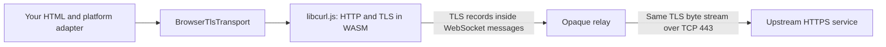

# Architecture

The reusable part of 0media is a way to keep HTTP request construction and upstream TLS inside the user's browser while using a small server to provide TCP connectivity. The client UI can be anything that calls a JavaScript function.

## The layers

The browser's native network stack normally owns HTTPS when an application calls `window.fetch`. Here, a compiled libcurl stack owns HTTP and TLS. Its socket operations are carried over a WebSocket to the relay. The relay opens a TCP connection and copies the bytes. It has no HTTP response parser, cookie jar, upstream TLS context, or platform account session.

There are two distinct TLS connections in a remote deployment:

- **Outer TLS:** the browser's native WebSocket implementation connects to `wss://relay.example.org`. This connection ends at the relay's HTTPS ingress. It protects the WebSocket connection and its target path on the intervening network.
- **Inner TLS:** libcurl.js connects logically to `https://example.com`. That TLS session ends at the upstream service, including any CDN that terminates TLS for it. The relay copies these records without terminating this connection.

The local quickstart uses `ws://127.0.0.1` for the outer connection. It retains inner TLS. Adding server-side HTTPS fetching to the relay would change this architecture: that server would then see decrypted HTTP.

## One request, step by step

1. The HTML submit handler builds the URL, method, headers, body, and abort signal. Nothing is sent automatically when the form loads.
2. `BrowserTlsTransport.fetch()` constructs a `Request`, checks the destination policy, and checks cancellation before initialization.
3. On first use, the wrapper imports the pinned bundled libcurl.js package, selects its `wsproxy` socket transport, and creates an owned `HTTPSession`. The page can share that transport instance across requests.
4. libcurl prepares HTTP and establishes upstream TLS through its WebSocket socket shim. For the default request the relay sees an upgrade at `/ws/example.com%3A443` or the equivalent decoded authority.
5. The Python relay checks the browser Origin, its own Host header, destination authority, and available capacity. It resolves the destination, filters out non-public addresses, and connects to one of the resulting IPs on port 443.
6. Browser-to-relay binary messages become TCP bytes. TCP reads become relay-to-browser binary messages. Message boundaries are not HTTP or TLS record boundaries; the preserved byte order is what matters.
7. libcurl verifies the upstream TLS peer using its TLS implementation and trust material, decrypts HTTP, and exposes a `Response`. This project does not disable certificate verification or install a custom CA. Certificate and trust-store maintenance belong to the WASM dependency; they are not inherited automatically from the operating system's browser trust store. See [upstream libcurl.js](https://github.com/ading2210/libcurl.js) and [curl's peer-verification option](https://curl.se/libcurl/c/CURLOPT_SSL_VERIFYPEER.html).
8. The example reads at most 256 KiB of response data and renders it with `textContent`. It aborts the completed HTTP handle in `finally` and keeps the session available for another request until the user closes it.

The relay counts encrypted TCP payload bytes. The client bounds the response bytes after the HTTP library has processed them. Those measurements can differ because TLS framing, HTTP headers, and compression exist between them.

## Trust and visibility

| Participant | What it can observe |
| --- | --- |
| Your application JavaScript and WASM | Complete URLs, request and response bodies, supplied headers, and any cookies enabled in the session. |
| Relay operator and its WSS ingress | Client connection metadata, approved destination hostname and port, destination IP, timing, direction, and byte counts. TLS handshakes can also reveal metadata. |
| Upstream HTTPS service | Decrypted requests and credentials you intentionally send, and the relay's outbound IP. |
| Client code host and software supply chain | The ability to change code that will later handle plaintext in the user's page. |

With correctly authenticated inner TLS and uncompromised client code, the relay cannot decrypt HTTP paths, cookies, or bodies merely by forwarding the connection. It can still refuse connections, delay or truncate them, and record traffic metadata. This is not an anonymity network, traffic-padding system, or end-to-end encrypted social messaging protocol. A logged-in service can identify the account regardless of the relay's address.

The code host is a critical trust boundary. Serving malicious JavaScript would expose plaintext before encryption or after decryption. A service worker is also privileged same-origin application code. Keeping the relay opaque does not remove either of these risks.

The relay deliberately does not inspect whether the copied bytes are valid TLS. Its enforcement unit is an allowed hostname and port. Once a tunnel is accepted, a modified client can send arbitrary bytes to that approved socket. Consequently the relay cannot enforce HTTP methods, paths, account permissions, or per-request API limits inside the tunnel.

## Why the browser policy is not enough

The destination list in `transport/policy.ts` helps application code reject mistakes early. Anyone can modify their browser code or connect with a different WebSocket client. The Python relay repeats destination enforcement independently and applies public-IP checks immediately before connecting.

Origin restrictions prevent an ordinary unrelated webpage from using the relay with its own browser Origin. Origin is not authentication: non-browser clients can supply that header themselves. Public services need additional admission controls and abuse limits outside the encrypted content.

## What stays above the transport

The transport understands HTTPS, cookies, cancellation, responses, and byte streams. It does not understand timelines, posts, follows, likes, OAuth scopes, CSRF fields, login challenges, or the difference between Instagram and a custom API. Those belong in a platform adapter written by the client author.

The reusable media layer follows the same rule. It takes an approved media URL and an injected `fetch` function. A platform adapter decides where that URL came from and which rendition the user requested.

The original platform-specific login and remote verification machinery is not part of this standalone core. It is coupled to particular service flows and has a different trust model involving a server-side browser. A service-specific integration should document its own boundaries explicitly.
