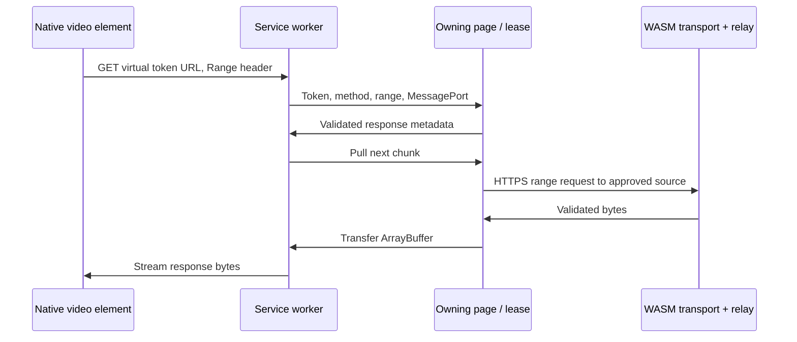

# Media through the encrypted transport

Media support is optional. The basic request form does not create image or video loaders or register a service worker. These modules are included so a client can later display media without sending the upstream media URL directly to native browser networking.

## Images

`ImageLoader` accepts a `FetchLike` function. Inject `transport.fetch` to keep its upstream requests inside browser-owned TLS:

```js
import { ImageLoader } from "./transport/index.ts";

const images = new ImageLoader(transport.fetch);
const owner = new AbortController();
const url = await images.load(approvedImageUrl, owner.signal);
if (url) document.querySelector("img").src = url;

// When the owning view/session ends:
owner.abort();
document.querySelector("img").removeAttribute("src");
images.close();
```

`approvedImageUrl` must be supplied by your adapter and pass the destination policy. Successful results are local `blob:` URLs. The native image element sees that blob URL rather than the remote address.

Requests for the same source share one in-progress download. Each caller owns a claim; cancelling one caller does not abort another caller's download. Once no callers remain, the shared controller is aborted. Failed work is removed so a later request can try again.

The loader permits four concurrent downloads, at most 128 pending source entries, a 20-second deadline including queue time, and 15 MiB per image. It checks both declared and actual byte counts and requires a successful `image/*` response. Most network or content failures return `undefined`; an already-aborted caller or admission rejection can reject the promise.

Successful blobs are cached until `images.close()`. There is no aggregate successful-cache byte cap or per-image release method. A long-running scrolling client must add eviction/viewport ownership or scope loaders to short-lived views. Closing the loader revokes all its blobs and aborts pending work; it should happen after removing their DOM references.

## Video leases

`VideoLoader` registers a logical ID and one or more approved source URLs. Each successful `load` returns a `VideoLease` that owns the playback URL:

```js
import { VideoLoader, updateApplicationWorker } from "./transport/index.ts";

await updateApplicationWorker(); // Optional progressive path; uses /sw.js.
const videos = new VideoLoader(transport.fetch);
videos.register("clip", approvedVideoUrl, approvedSmallerAlternatives);
const owner = new AbortController();
const lease = await videos.load("clip", owner.signal);
const video = document.querySelector("video");
video.controls = true;
video.src = lease.url;
const stopListening = lease.onInvalidated?.(() => {
  video.pause();
  // Show an explicit retry action in your own interface.
});

// On navigation, replacement, or logout:
video.pause();
video.removeAttribute("src");
video.load();
stopListening?.();
owner.abort();
lease.release();
videos.close();
```

The variables beginning with `approved` are values supplied by your integration; the demo domain does not provide sample video files. Remove/reload a native element's source before releasing its URL. `release()` is idempotent. A caller's abort signal stops work, but the caller must still release an already-published lease to return its capacity.

The loader retains up to 200 registered IDs. A source may have up to three alternatives, deduplicated with the primary. It admits at most two downloads or live leases combined and at most 12 outstanding load requests. A displayed video continues to occupy a slot until release. Waiting for local capacity has no network deadline; cancel unused requests when their views disappear.

The loader first attempts progressive playback when a compatible worker actually controls the page. If that facility is unavailable, or the initial range request receives a valid video response with status 200 instead of range support, it uses a bounded blob download. A malformed 206, authentication failure, rate limit, or ordinary network error does not trigger that fallback. Blob downloads allow MP4 or WebM, at most 24 MiB, and 30 seconds after admission and progressive setup.

An oversized blob advances the registered alternative index for the next explicit `load` attempt. It does not loop through variants automatically. A smaller rendition may succeed on a user retry. The adapter is responsible for ordering real alternatives sensibly; the loader does not know a platform's rendition metadata.

## Progressive playback without exposing the remote URL

Native `<video>` elements normally issue their own HTTP range requests. To keep those requests in the page's WASM transport, the bridge gives the element a same-origin virtual URL:

```text
https://your-client.example/_0media/video/<random-UUID>
```

The random token identifies a page-owned lease. It is not an upstream URL, a login token, or a durable share link.



`video-bridge.ts` keeps the actual remote URL, TLS transport, and lease map in the page. `public/video-sw.js` finds the requesting same-origin client and asks that client for the requested token. The worker does not receive the remote URL or cookie jar. It does receive decrypted video bytes so it can feed the browser decoder; it remains trusted client code.

Before creating a lease, the page checks the exact worker script `/sw.js`, the message protocol/version, and a real fetch-interception probe. A worker answering a message is insufficient if a reload has bypassed its fetch interception. The probe uses an invalid token and requires status 410 with `x-0media-video-bridge: 3`; it never fetches upstream media.

Root-relative worker and virtual paths are intentional. Serve the application at an origin root or adapt all related paths and scope checks together. If your application already owns a root service worker, integrate the listener there and preserve its early interception of reserved video paths. Do not blindly replace another application's worker.

## Range validation and bounds

The initial metadata request is `Range: bytes=0-1`. Later pulls request chunks of at most 1 MiB. `readVideoRange()` requires status 206, a precise `Content-Range`, MP4/WebM content type, identity content encoding, and exactly the expected number of actual response bytes. It rejects mismatched Content-Length, truncated/oversized chunks, malformed ranges, and representations over 512 MiB.

Every subsequent chunk must retain the original size, MIME type, ETag, and Last-Modified value. A strong ETag or Last-Modified is sent through `If-Range` when available. If a service supplies neither, comparing missing validators cannot prove the content is unchanged; an immutable source URL is preferable. Multi-range requests are unsupported. Single bounded, open-ended, and suffix ranges are handled.

There are two active upstream range requests across this page's bridge, up to four open streams per lease, a 20-second deadline per upstream range, and a 45-second page-side idle port timer. The worker waits up to four seconds for initial headers and 25 seconds for a pulled chunk, and sends keepalives every 15 seconds while a playback stream is alive. Its stream uses a zero high-water mark and requests a new chunk on demand.

The 512 MiB limit describes a whole media representation, not an allocation of that size or a promise that the default relay budget can deliver it uninterrupted. A reused tunnel can exhaust the relay's 32 MiB directional cap. Handle playback failure and explicit retry rather than silently switching to a direct CDN URL.

Navigation or a worker-controller change invalidates progressive leases. Late results cannot publish a new playback URL after cancellation. `failure()` exposes a bounded protocol error when available, and `onInvalidated()` lets the UI react to a controller change. None of the media code persists video in Cache Storage or implements HLS, DASH, DRM, transcoding, or platform authorization.
